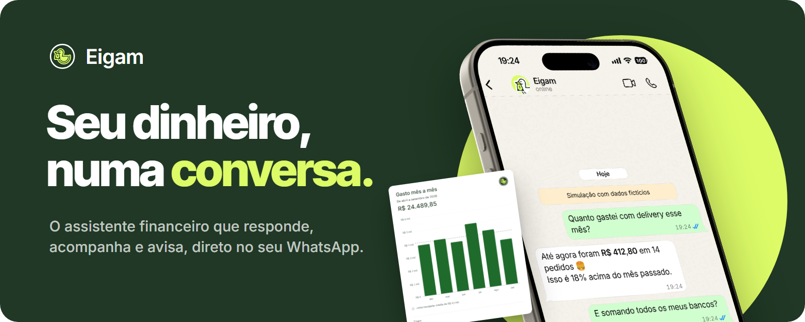
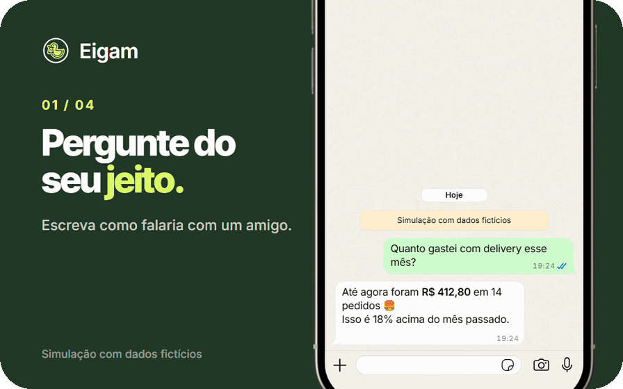
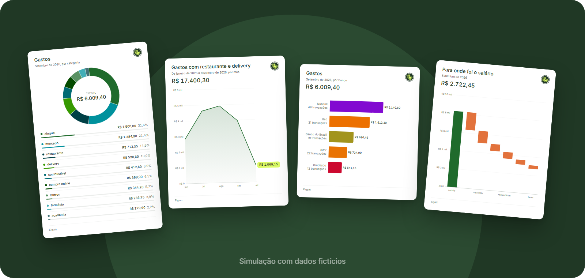

<a href="https://eigam.com.br">
  <picture>
    <source media="(prefers-color-scheme: dark)" srcset="assets/banner-escuro.png">
    <source media="(prefers-color-scheme: light)" srcset="assets/banner-claro.png">
    
  </picture>
</a>

  <a href="https://eigam.com.br"><b>eigam.com.br</b></a>
  &nbsp;·&nbsp;
  <a href="mailto:contato@eigam.com.br">contato@eigam.com.br</a>

 

O **Eigam** é um assistente financeiro pessoal que funciona dentro do
WhatsApp. Em vez de abrir um aplicativo para cada banco, você pergunta o que
quer saber e recebe a resposta na hora: quanto gastou, quanto tem somando
todas as contas e o que vem pela frente.

  

## O que o Eigam faz

  
  

  
  

## Como funciona

**1. Chame o Eigam no WhatsApp.** Sem instalar nada novo: a conversa fica
junto das outras, no aplicativo que você já usa.

**2. Conecte suas contas.** A conexão é feita pelo Open Finance e só acontece
com a sua autorização. Você escolhe quais contas compartilhar.

**3. Pergunte.** "Quanto gastei com mercado?", "Quanto sobrou no mês
passado?", "Me avisa se o saldo apertar." O Eigam responde em texto e,
quando ajuda, com um gráfico.

## Gráficos feitos para a conversa

Gastos por categoria, por banco ou mês a mês, patrimônio, o que entrou e o que
sobrou. Cada gráfico chega como uma imagem pensada para a tela do celular,
com o valor que importa em destaque.

  

 

  
    Conversas, nomes e valores das imagens são simulações com dados fictícios.
    &nbsp;·&nbsp;
    <a href="https://eigam.com.br/termos">Termos de Serviço</a>
    &nbsp;·&nbsp;
    <a href="https://eigam.com.br/privacidade">Privacidade</a>
  

